# Práctica 15 – El gimnasio: rutas y layout

## Ejercicio 1: el router y el catálogo

### ¿Por qué el 404 sí tiene encabezado y pie?

Porque la ruta del 404 está metida dentro de la ruta del layout, igual que las demás páginas. El layout es el que tiene el encabezado, el pie y el hueco donde se pinta cada página, así que cualquier página que esté dentro de él los trae, también el 404. Lo comprobé entrando a una dirección inventada (`/no-existe`) y salen el encabezado arriba y el pie abajo.

### ¿Qué cambia en la pestaña Red si usas `<a href>` en lugar de `Link`?

Con `Link`, al hacer clic en una tarjeta solo aparecieron 2 filas en la pestaña Red, y ninguna era de tipo `document`. Eso quiere decir que la página no se recargó: solo cambió la dirección y pidió los datos de la clase.

Con `<a href>` salieron 32 filas, y la primera sí era de tipo `document`. Eso quiere decir que el navegador volvió a pedir la página completa y todos sus archivos, o sea que se recargó todo.

Con `Link`:

Con `<a href>`:

## Ejercicio 2: el detalle de una clase

### ¿En qué tipo de dato llega el id de la URL y qué pasa si no lo conviertes?

Llega como texto (`string`), y hasta puede ser `undefined` si no viene en la dirección. El hook `useClase` pide un número, así que si no lo convierto con `Number(id)` el editor marca un error rojo diciendo que un `string | undefined` no se puede usar donde va un `number`. Lo probé quitando el `Number` y el error salió. En el navegador `/clases/1` sí cargó igual, pero aun así el error de TypeScript se queda.

### ¿Qué pasa al ir de `/clases/1` a `/clases/2` si el id no está en las dependencias del efecto?

Esto no lo pude probar en el navegador, pero supongo que cuando el `id` no está en las dependencias, solo corre la primera vez que se muestra la página. Si cambio de `/clases/1` a `/clases/2` sin salir de esa página, React reutiliza la misma página y el efecto no vuelve a correr, así que la URL diría `/clases/2` pero seguiría mostrando la clase 1. Por eso el `id` va en las dependencias.

---

# Práctica 16 – El gimnasio: sesión con contexto y JWT

## Ejercicio 1: el contexto de sesión

### ¿Por qué se usa un contexto y no props para la sesión?

Porque la sesión la necesitan varios componentes, por ejemplo el encabezado (para el nombre y el botón Salir) y las páginas de entrar y de registro. Con props tendría que pasar el usuario de componente en componente, aunque los del medio no lo usen. Con el contexto se guarda en un solo lugar y cada componente que lo necesite lo lee directo con `useSesion()`. 

### ¿Qué pasa si un componente usa la sesión fuera del proveedor?

Lo probé quitando temporalmente el `ProveedorSesion` de `main.tsx`. La página se quedó en blanco, solo con el fondo, y en la consola salió un error en rojo: «Uncaught Error: useSesion() tiene que usarse dentro del componente <ProveedorSesion>», diciendo que venía del `Encabezado`. O sea que el hook avisa con un error cuando no hay proveedor, y como nadie lo atrapa, se cae toda la página.

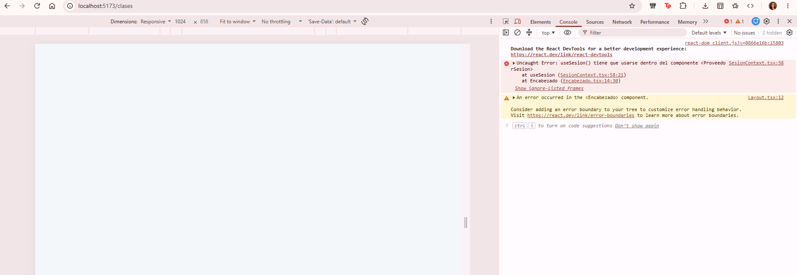

Capturas de este ejercicio: el encabezado con la sesión iniciada (con el nombre y el botón Salir):

## Ejercicio 2: entrar y mandar el token

### ¿Dónde se guarda el token y qué riesgo tiene ese lugar?

Se guarda en el `localStorage` del navegador, junto con los datos del usuario. Lo comprobé en modo dveloper, en la pestaña application, y ahí aparecen las llaves `token` y `usuario`. El riesgo es que cualquier código de JavaScript que corra en la página puede leerlo, así que si alguien logra meter un script malicioso, podría robar el token y usarlo. 

### Comprobar en la pestaña Red que las peticiones llevan el encabezado Authorization y leer el token en jwt.io

Después de entrar con `karla@itson.mx`, la petición `GET http://localhost:3000/clases` sale con el encabezado `Authorization: Bearer ...` seguido del token.

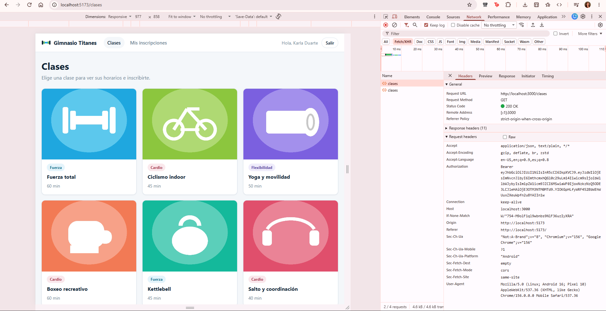

Copié ese token en jwt.io. El encabezado dice que usa el algoritmo HS256 y que es de tipo JWT. El payload trae `sub` (1), `correo` (karla@itson.mx), `rol` (miembro), `miembroId` (1), `iat` y `exp`. La diferencia entre `exp` e `iat` es de 3600 segundos, o sea que el token dura una hora.

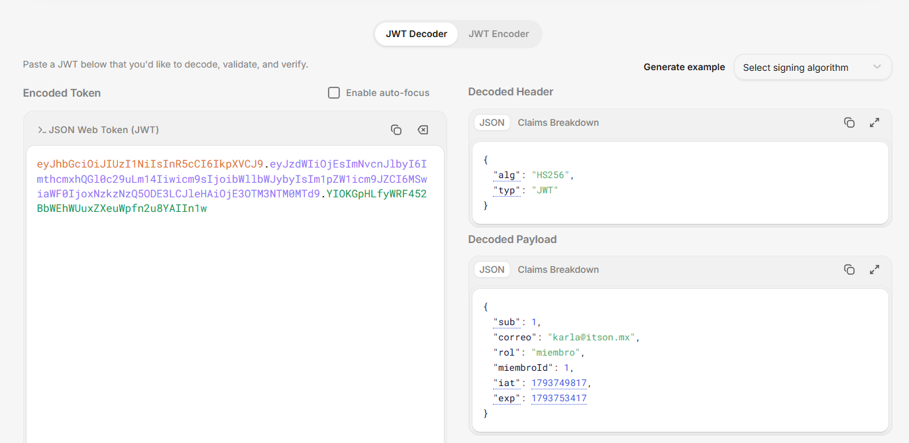

Otras capturas de este ejercicio: el error cuando las credenciales son incorrectas y la cuenta nueva creada con el registro.

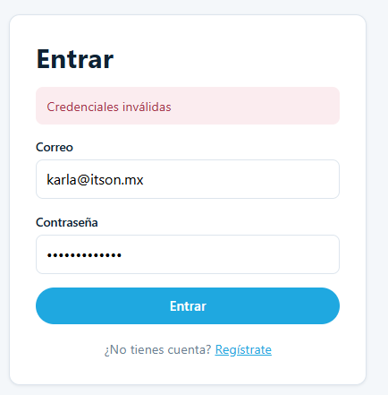

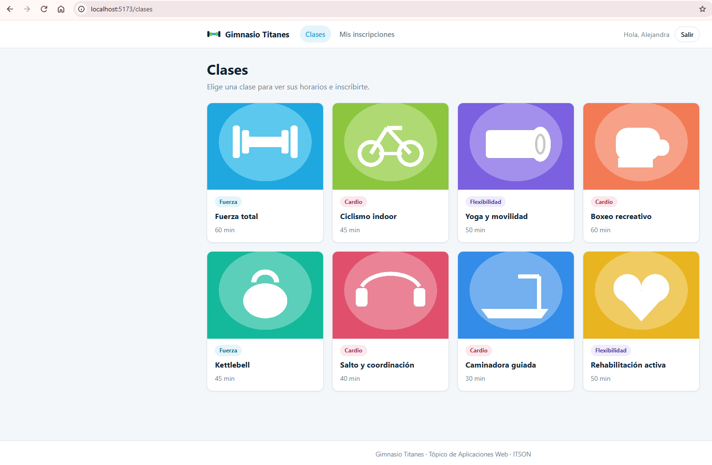

---

# Práctica 17 – El gimnasio: rutas protegidas e inscripciones

## Ejercicio 1: mis inscripciones, sólo con sesión

Sin sesión, al pulsar «Mis inscripciones» me manda a `/entrar`, y después de entrar con Karla me regresa a `/mis-inscripciones`.

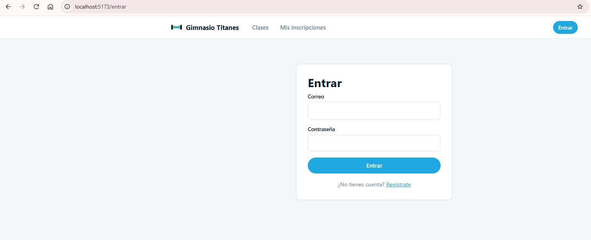

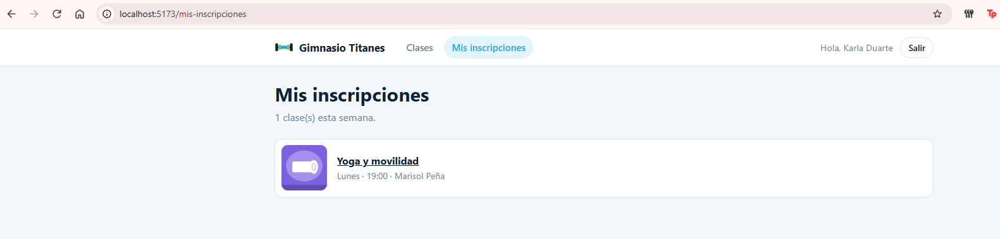

### ¿La ruta protegida hace segura la aplicación? ¿Qué es lo que de verdad protege los datos?

No, la ruta protegida sola no hace segura la aplicación. Lo único que hace es esconder la página a quien no tiene sesión, pero todo ese código ya está en el navegador de la persona y se puede cambiar. Lo vi cuando cambié el token por uno falso: como el usuario seguía guardado, la ruta me dejó pasar a la página, pero los datos no llegaron, porque la API contestó 401. Lo que de verdad protege los datos es la API (el backend), que revisa el token en cada petición y no entrega nada si no es válido.

### Comprobar con curl que GET /inscripciones/mias sin token responde 401

Corrí `curl -i http://localhost:3000/inscripciones/mias` sin mandar ningún token y la respuesta fue `HTTP/1.1 401 Unauthorized`, con el mensaje `{"message":"Unauthorized","statusCode":401}`.

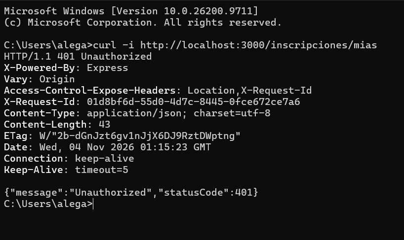

## Ejercicio 2: inscribirse y el 401

Con la sesión de Karla me inscribí al lunes 07:00 de Fuerza total. Salió el aviso verde y los lugares bajaron de 20 a 19 sin que yo recargara la página.

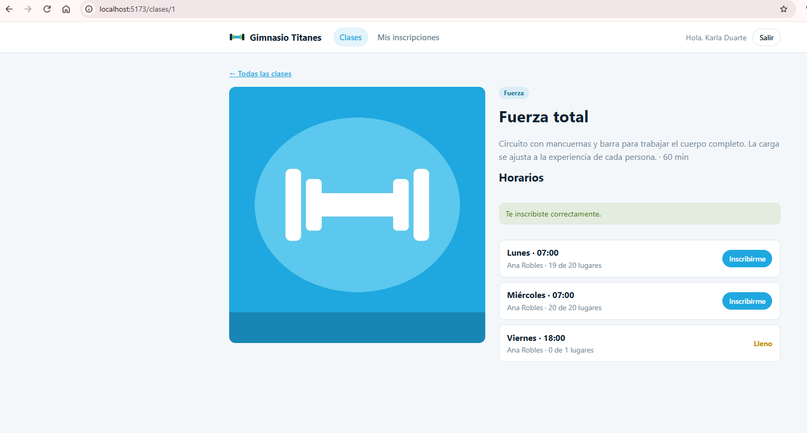

Al pulsar Inscribirme otra vez en el mismo horario salió el error 409, con el mensaje de la API: «Ya estás inscrito en este horario».

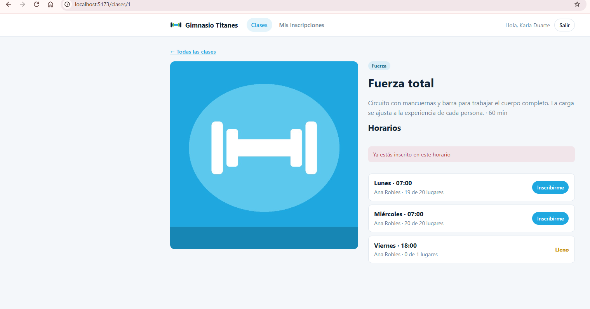

Con la cuenta de Ana que es entrenadora salió el error 403, con el mensaje de la API: «Tu cuenta no es de un miembro del gimnasio».

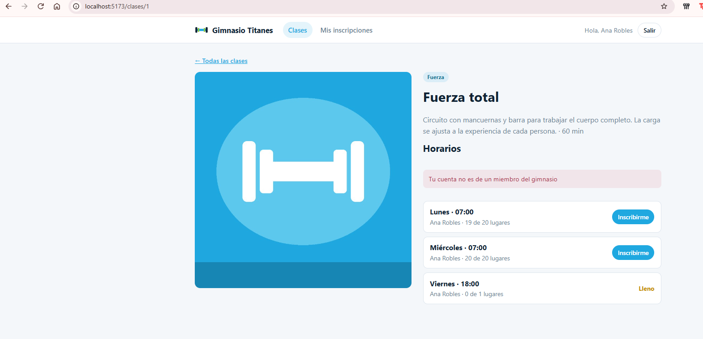

Cambié el token guardado por uno falso y entré a Mis inscripciones. La API contestó 401, la sesión se cerró sola, el encabezado volvió a mostrar el botón Entrar y quedé en `/entrar`. En el Local Storage ya no estaban el token ni el usuario.

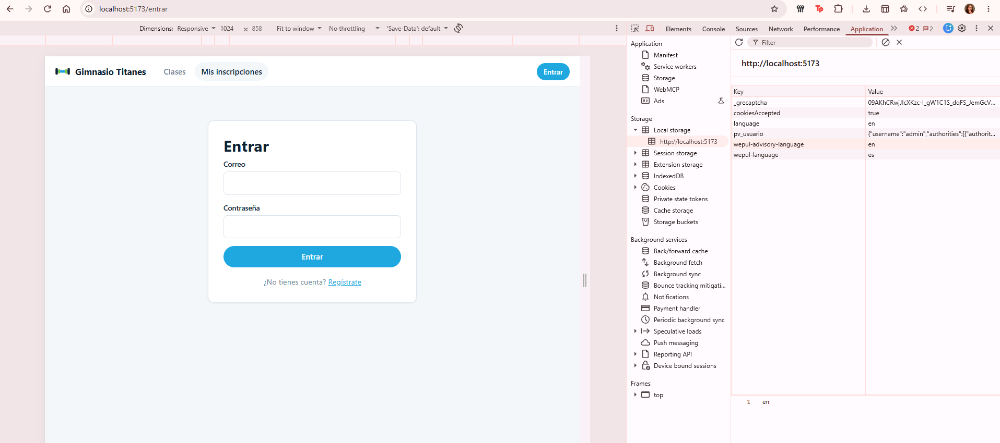

### ¿Por qué no se manda el miembroId al inscribirse?

Porque la API ya sabe quién soy por el token que va en cada petición, y de ahí saca mi `miembroId`. Si el frontend lo mandara, cualquiera podría cambiarlo y tratar de inscribir a otra persona, la API usa solo el que viene en el token.

### ¿Qué diferencia hay entre un 401 y un 403?

El 401 quiere decir que la API no sabe quién eres: no mandaste token, o el token es falso o ya venció. El 403 quiere decir que la API si sabe quién eres, pero tu cuenta no tiene permiso para hacer eso. En el frontend, el 401 cierra la sesión, y el 403 solo muestra el mensaje.
