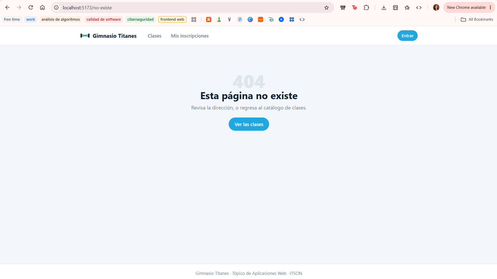
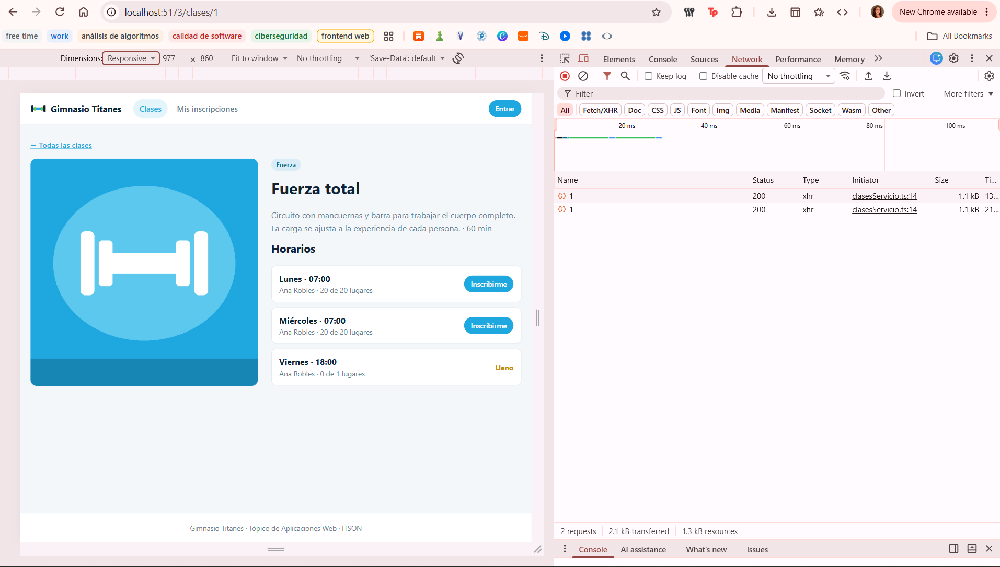
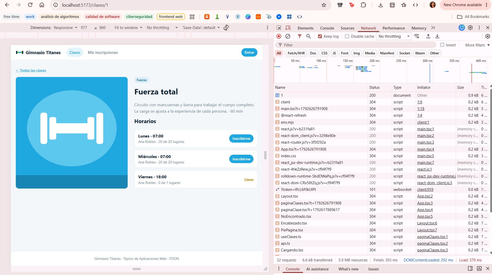

# Práctica 15 – El gimnasio: rutas y layout

## Ejercicio 1: el router y el catálogo

### ¿Por qué el 404 sí tiene encabezado y pie?

Porque la ruta del 404 está metida dentro de la ruta del layout, igual que las demás páginas. El layout es el que tiene el encabezado, el pie y el hueco donde se pinta cada página, así que cualquier página que esté dentro de él los trae, también el 404. Lo comprobé entrando a una dirección inventada (`/no-existe`) y salen el encabezado arriba y el pie abajo.

### ¿Qué cambia en la pestaña Red si usas `<a href>` en lugar de `Link`?

Con `Link`, al hacer clic en una tarjeta solo aparecieron 2 filas en la pestaña Red, y ninguna era de tipo `document`. Eso quiere decir que la página no se recargó: solo cambió la dirección y pidió los datos de la clase.

Con `<a href>` salieron 32 filas, y la primera sí era de tipo `document`. Eso quiere decir que el navegador volvió a pedir la página completa y todos sus archivos, o sea que se recargó todo.

Con `Link`:

Con `<a href>`:

## Ejercicio 2: el detalle de una clase

### ¿En qué tipo de dato llega el id de la URL y qué pasa si no lo conviertes?

Llega como texto (`string`), y hasta puede ser `undefined` si no viene en la dirección. El hook `useClase` pide un número, así que si no lo convierto con `Number(id)` el editor marca un error rojo diciendo que un `string | undefined` no se puede usar donde va un `number`. Lo probé quitando el `Number` y el error salió. En el navegador `/clases/1` sí cargó igual, pero aun así el error de TypeScript se queda.

### ¿Qué pasa al ir de `/clases/1` a `/clases/2` si el id no está en las dependencias del efecto?

Esto no lo pude probar en el navegador, pero supongo que cuando el `id` no está en las dependencias, solo corre la primera vez que se muestra la página. Si cambio de `/clases/1` a `/clases/2` sin salir de esa página, React reutiliza la misma página y el efecto no vuelve a correr, así que la URL diría `/clases/2` pero seguiría mostrando la clase 1. Por eso el `id` va en las dependencias.
